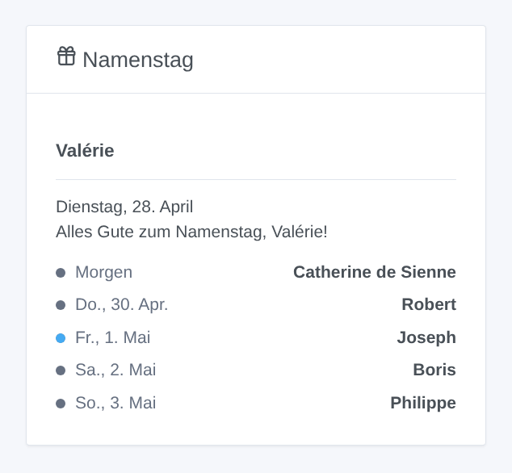
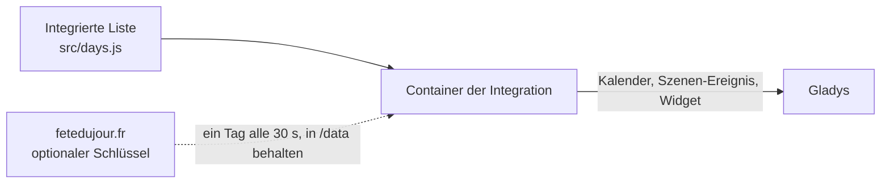

# Gladys Fête du jour

[English](README.md) · [Français](README.fr.md) · **Deutsch** · [Español](README.es.md)

[](LICENSE)
[](https://github.com/William-De71/gladys-fete-du-jour/releases)
[](https://github.com/William-De71/gladys-fete-du-jour/actions/workflows/release.yml)
[](https://gladysassistant.com)


Externe Integration für [Gladys Assistant](https://gladysassistant.com), die die Namenstage des traditionellen französischen Kalenders in Gladys bringt: ein Kalender, ein Szenen-Auslöser, eine Szenen-Aktion und ein Dashboard-Widget. Die Namen stammen aus einer integrierten Liste (ohne Verbindung, nichts einzustellen) oder von [fetedujour.fr](https://fetedujour.fr) mit Ihrem eigenen Schlüssel.

Benutzerdokumentation: [English](docs/en.md) · [Français](docs/fr.md) · [Deutsch](docs/de.md) · [Español](docs/es.md).

## Funktionen

- Ein **Gladys-Kalender „Namenstage“** für jeden Benutzer, der die Integration unter „Meine Kalender“ aktiviert: ein ganztägiges Ereignis pro Tag („Namenstag: Valérie“, „Fête nationale · Namenstag: Camille“), von 7 Tagen zurück bis ein Jahr voraus, in der Sprache jedes Benutzers.
- **Integrierte Liste**: der traditionelle französische Kalender, ein Heiliger pro Tag (351 Vornamen) und die Feste, nach Wikipedia korrigiert; funktioniert ohne Verbindung.
- **fetedujour.fr** (optional): Mit einem kostenlosen, an Ihre feste öffentliche IP-Adresse gebundenen Schlüssel wird jeder Tag nur einmal abgefragt (eine Anfrage alle 30 Sekunden) und behalten; die integrierte Liste übernimmt, sobald der Schlüssel abgelehnt wird oder die Seite nicht antwortet.
- **Szenen-Auslöser** „Namenstag“, jeden Tag zur gewählten Stunde, optional nur am Namenstag gewählter Vornamen. **Szenen-Aktion** „Namenstag abrufen“ (heute oder morgen), mit einem fertigen Satz.
- **Widget** „Namenstag“: heute und die nächsten Tage.
- Tage in der **Zeitzone von Gladys**; vier Sprachen überall: Englisch, Französisch, Deutsch, Spanisch.



## Funktionsweise



## Voraussetzungen

- Gladys Assistant **5.2.0** oder neuer (Kalender-Integrationen).
- Nur für fetedujour.fr: ein kostenloser Schlüssel und eine feste öffentliche IP-Adresse.

## Installation

1. Öffnen Sie in Gladys **Integrationen**, suchen Sie **Fête du jour** und installieren Sie sie.
2. Fügen Sie optional Ihren fetedujour.fr-Schlüssel ein und klicken Sie unter **Meine Kalender** auf **Für mich aktivieren**; teilen Sie den Kalender mit dem Haushalt, um ihn in Szenen zu nutzen.
3. Fügen Sie das Widget einem Dashboard hinzu und erstellen Sie Szenen mit dem Auslöser und der Aktion.

## Entwicklung

```bash
npm install
npm test                       # node --test, ohne je das Netz zu berühren
npm run lint && npm run format:check
npx github:GladysAssistant/integration-store . --skip-image-check
node scripts/sync-names.mjs    # Vornamen der Liste -> Manifest
scripts/build-cover.sh         # cover.jpg aus docs/assets/cover.svg
docs/illustrations/render.sh   # docs/assets/widgets.<sprache>.png
node .github/scripts/release.mjs next
```

Lokal liest das SDK `GLADYS_HOST_API_URL`, `GLADYS_INTEGRATION_TOKEN` und `GLADYS_INTEGRATION_SELECTOR`, und `TZ` legt die Zeitzone der Tage fest; `DEBUG=gladys-integration-sdk` zeigt die SDK-Protokolle und prüft jeden Widget-Inhalt. Die Tests simulieren fetedujour.fr. Die Regeln des Projekts stehen in [CLAUDE.md](CLAUDE.md).

## Release-Prozess


Jeder Merge auf `main` startet die CI und berechnet dann die Version aus den [Conventional Commits](https://www.conventionalcommits.org/de/) seit dem letzten Tag: `feat` → Minor, `fix` / `perf` → Patch, `!` oder `BREAKING CHANGE` → Major (ein Minor vor 1.0.0); `docs`, `chore`, `ci`, `test`, `style`, `refactor`, `build` allein veröffentlichen nichts. Der Changelog-Abschnitt wird erzeugt, der Tag gepusht, das Multi-Arch-Image gebaut, dann erhält `main` den Release-Commit, das GitHub Release wird erstellt und ein letzter Job prüft das öffentliche Image, den Store-Validator und das Topic.

- Der Titel des Pull Requests wird zum Squash-Commit und dann zur Changelog-Zeile: Schreiben Sie ihn auf Englisch, für den Benutzer (`pr-title.yml` prüft ihn). Bearbeiten Sie `CHANGELOG.md` nie von Hand.
- 1.0.0 ist eine Entscheidung: Actions → Release → Run workflow mit `release-as: 1.0.0`. `dry-run` zeigt Version und Notizen, ohne etwas zu veröffentlichen.
- Machen Sie das `ghcr.io`-Paket nach dem ersten Release öffentlich (Package settings → Change visibility), sonst kann Gladys es nicht herunterladen.

## Mitwirken

Issues und Pull Requests sind willkommen. Führen Sie vor einem Pull Request `npm run format:check && npm run lint && npm test` aus, und ändern Sie keinen gespeicherten Schlüssel (Schlüssel der Vornamen, externe IDs: siehe [CLAUDE.md](CLAUDE.md)). Ein falscher Name in der integrierten Liste: Öffnen Sie ein Issue mit einer Quelle.

## Sicherheit

Siehe [SECURITY.md](SECURITY.md): Melden Sie Schwachstellen vertraulich. Der fetedujour.fr-Schlüssel ist ein geheimes Feld und wird nie protokolliert; die Integration läuft schreibgeschützt, ohne Root-Rechte, in ihrem Container und kontaktiert nur fetedujour.fr (wenn ein Schlüssel gesetzt ist).

## Lizenz

[Apache-2.0](LICENSE). Die integrierte Liste ist von [scriptable-fete-du-jour](https://github.com/monsieurm/scriptable-fete-du-jour) (MIT) abgeleitet: siehe [NOTICE](NOTICE). Nicht mit fetedujour.fr verbunden.
