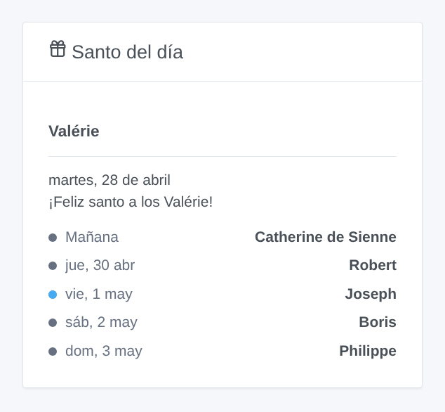
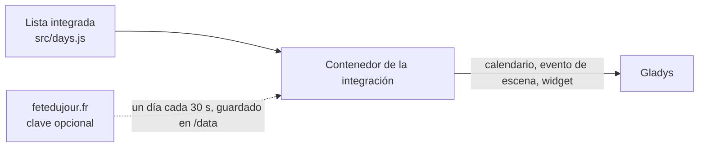

# Gladys Fête du jour

[English](README.md) · [Français](README.fr.md) · [Deutsch](README.de.md) · **Español**

[](LICENSE)
[](https://github.com/William-De71/gladys-fete-du-jour/releases)
[](https://github.com/William-De71/gladys-fete-du-jour/actions/workflows/release.yml)
[](https://gladysassistant.com)


Integración externa de [Gladys Assistant](https://gladysassistant.com) que trae a Gladys el santoral del calendario tradicional francés: un calendario, un disparador de escena, una acción de escena y un widget del panel. Los nombres proceden de una lista integrada (sin conexión, nada que ajustar) o de [fetedujour.fr](https://fetedujour.fr) con su propia clave.

Documentación de usuario: [English](docs/en.md) · [Français](docs/fr.md) · [Deutsch](docs/de.md) · [Español](docs/es.md).

## Funciones

- Un **calendario de Gladys «Santoral»** para cada usuario que active la integración en «Mis calendarios»: un evento de día completo por día («Santo: Valérie», «Fête nationale · Santo: Camille»), desde 7 días atrás hasta un año por delante, en el idioma de cada usuario.
- **Lista integrada**: el calendario tradicional francés, un santo por día (351 nombres) y las fiestas, corregido según Wikipedia; funciona sin conexión.
- **fetedujour.fr** (opcional): con una clave gratuita vinculada a su IP pública fija, cada día se pide una sola vez (una petición cada 30 segundos) y se conserva; la lista integrada toma el relevo en cuanto la clave es rechazada o el sitio no responde.
- **Disparador de escena** «Santo del día», cada día a la hora elegida, opcionalmente solo el día del santo de nombres elegidos. **Acción de escena** «Obtener el santo del día» (hoy o mañana), con una frase lista.
- **Widget** «Santo del día»: hoy y los próximos días.
- Días en la **zona horaria de Gladys**; cuatro idiomas en todas partes: inglés, francés, alemán, español.



## Funcionamiento



## Requisitos

- Gladys Assistant **5.2.0** o posterior (integraciones de calendario).
- Solo para fetedujour.fr: una clave gratuita y una dirección IP pública fija.

## Instalación

1. En Gladys, abra **Integraciones**, busque **Fête du jour** e instálela.
2. Pegue opcionalmente su clave de fetedujour.fr y pulse **Activar para mí** en **Mis calendarios**; comparta el calendario con el hogar para usarlo en escenas.
3. Añada el widget a un panel y cree escenas con el disparador y la acción.

## Desarrollo

```bash
npm install
npm test                       # node --test, sin tocar nunca la red
npm run lint && npm run format:check
npx github:GladysAssistant/integration-store . --skip-image-check
node scripts/sync-names.mjs    # nombres de la lista -> manifiesto
scripts/build-cover.sh         # cover.jpg desde docs/assets/cover.svg
docs/illustrations/render.sh   # docs/assets/widgets.<idioma>.png
node .github/scripts/release.mjs next
```

En local, el SDK lee `GLADYS_HOST_API_URL`, `GLADYS_INTEGRATION_TOKEN` y `GLADYS_INTEGRATION_SELECTOR`, y `TZ` fija la zona horaria de los días; `DEBUG=gladys-integration-sdk` muestra los registros del SDK y comprueba cada contenido de widget. Las pruebas simulan fetedujour.fr. Las reglas del proyecto están en [CLAUDE.md](CLAUDE.md).

## Proceso de release


Cada fusión en `main` lanza la CI y calcula la versión a partir de los [Conventional Commits](https://www.conventionalcommits.org/es/) desde el último tag: `feat` → menor, `fix` / `perf` → parche, `!` o `BREAKING CHANGE` → mayor (una menor antes de 1.0.0); `docs`, `chore`, `ci`, `test`, `style`, `refactor`, `build` solos no publican nada. Se genera la sección del changelog, se empuja el tag, se construye la imagen multiarquitectura, luego `main` recibe el commit de release, se crea la GitHub Release y un último job comprueba la imagen pública, el validador del store y el topic.

- El título de la pull request se convierte en el commit de squash y luego en la línea del changelog: escríbalo en inglés, para el usuario (`pr-title.yml` lo comprueba). No edite nunca `CHANGELOG.md` a mano.
- La 1.0.0 es una decisión: Actions → Release → Run workflow con `release-as: 1.0.0`. `dry-run` muestra la versión y las notas sin publicar nada.
- Tras la primera release, haga público el paquete `ghcr.io` (Package settings → Change visibility), si no Gladys no puede descargarlo.

## Contribuir

Issues y pull requests bienvenidas. Ejecute `npm run format:check && npm run lint && npm test` antes de abrir una pull request, y no cambie ninguna clave almacenada (claves de los nombres, identificadores externos: ver [CLAUDE.md](CLAUDE.md)). Un nombre erróneo en la lista integrada: abra una issue con una fuente.

## Seguridad

Ver [SECURITY.md](SECURITY.md): informe de las vulnerabilidades en privado. La clave de fetedujour.fr es un campo secreto, nunca escrito en los registros; la integración se ejecuta en solo lectura, sin derechos de root, en su contenedor, y solo contacta con fetedujour.fr (cuando hay una clave).

## Licencia

[Apache-2.0](LICENSE). La lista integrada deriva de [scriptable-fete-du-jour](https://github.com/monsieurm/scriptable-fete-du-jour) (MIT): ver [NOTICE](NOTICE). Sin relación con fetedujour.fr.
