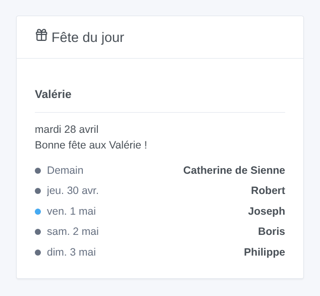
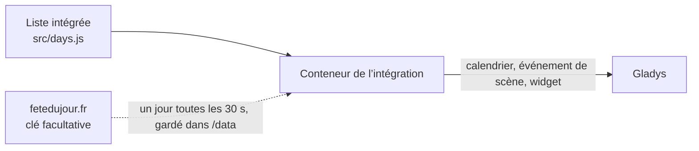

# Gladys Fête du jour

[English](README.md) · **Français** · [Deutsch](README.de.md) · [Español](README.es.md)

[](LICENSE)
[](https://github.com/William-De71/gladys-fete-du-jour/releases)
[](https://github.com/William-De71/gladys-fete-du-jour/actions/workflows/release.yml)
[](https://gladysassistant.com)


Intégration externe de [Gladys Assistant](https://gladysassistant.com) qui apporte dans Gladys les fêtes du calendrier traditionnel français : un calendrier, un déclencheur de scène, une action de scène et un widget de tableau de bord. Les noms viennent d’une liste intégrée (sans connexion, rien à régler) ou de [fetedujour.fr](https://fetedujour.fr) avec votre propre clé.

Documentation utilisateur : [English](docs/en.md) · [Français](docs/fr.md) · [Deutsch](docs/de.md) · [Español](docs/es.md).

## Fonctionnalités

- Un **calendrier Gladys « Fêtes du jour »** pour chaque utilisateur qui active l’intégration dans « Mes calendriers » : un événement d’une journée par jour (« Bonne fête Valérie », « Fête nationale · Bonne fête Camille »), de 7 jours en arrière à un an en avance, dans la langue de chaque utilisateur.
- **Liste intégrée** : le calendrier traditionnel français, un saint par jour (351 prénoms) et les fêtes, corrigé d’après Wikipédia ; fonctionne sans connexion.
- **fetedujour.fr** (facultatif) : avec une clé gratuite liée à votre adresse IP publique fixe, chaque jour est demandé une seule fois (une requête toutes les 30 secondes) puis conservé ; la liste intégrée prend le relais dès que la clé est refusée ou que le site ne répond pas.
- **Déclencheur de scène** « Fête du jour », chaque jour à l’heure choisie, éventuellement seulement le jour de la fête de prénoms choisis. **Action de scène** « Obtenir la fête du jour » (aujourd’hui ou demain), avec une phrase toute prête.
- **Widget** « Fête du jour » : aujourd’hui et les jours suivants.
- Jours dans le **fuseau horaire de Gladys** ; quatre langues partout : anglais, français, allemand, espagnol.



## Fonctionnement



## Prérequis

- Gladys Assistant **5.2.0** ou plus récent (intégrations de type calendrier).
- Pour fetedujour.fr seulement : une clé gratuite et une adresse IP publique fixe.

## Installation

1. Dans Gladys, ouvrez **Intégrations**, trouvez **Fête du jour** et installez-la.
2. Collez éventuellement votre clé fetedujour.fr, puis cliquez sur **Activer pour moi** dans **Mes calendriers** ; partagez le calendrier avec le foyer pour l’utiliser dans les scènes.
3. Ajoutez le widget à un tableau de bord, et créez des scènes avec le déclencheur et l’action.

## Développement

```bash
npm install
npm test                       # node --test, sans jamais toucher au réseau
npm run lint && npm run format:check
npx github:GladysAssistant/integration-store . --skip-image-check
node scripts/sync-names.mjs    # prénoms de la liste -> manifeste
scripts/build-cover.sh         # cover.jpg depuis docs/assets/cover.svg
docs/illustrations/render.sh   # docs/assets/widgets.<langue>.png
node .github/scripts/release.mjs next
```

En local, le SDK lit `GLADYS_HOST_API_URL`, `GLADYS_INTEGRATION_TOKEN` et `GLADYS_INTEGRATION_SELECTOR`, et `TZ` fixe le fuseau horaire des jours ; `DEBUG=gladys-integration-sdk` affiche les journaux du SDK et vérifie chaque contenu de widget. Les tests simulent fetedujour.fr. Les règles du projet sont dans [CLAUDE.md](CLAUDE.md).

## Processus de release


Chaque fusion sur `main` lance la CI, puis calcule la version à partir des [Conventional Commits](https://www.conventionalcommits.org/fr/) depuis le dernier tag : `feat` → mineure, `fix` / `perf` → correctif, `!` ou `BREAKING CHANGE` → majeure (une mineure avant 1.0.0) ; `docs`, `chore`, `ci`, `test`, `style`, `refactor`, `build` seuls ne publient rien. La section du changelog est générée, le tag poussé, l’image multi-architecture construite, puis `main` reçoit le commit de release, la GitHub Release est créée et un dernier job vérifie l’image publique, le validateur du store et le topic.

- Le titre de la pull request devient le commit de squash, puis la ligne du changelog : écrivez-le en anglais, pour l’utilisateur (`pr-title.yml` le vérifie). N’éditez jamais `CHANGELOG.md` à la main.
- La 1.0.0 est une décision : Actions → Release → Run workflow avec `release-as: 1.0.0`. `dry-run` montre la version et les notes sans rien publier.
- Après la première release, rendez le package `ghcr.io` public (Package settings → Change visibility), sinon Gladys ne peut pas le télécharger.

## Contribuer

Issues et pull requests bienvenues. Lancez `npm run format:check && npm run lint && npm test` avant d’ouvrir une pull request, et ne changez aucune clé stockée (clés des prénoms, identifiants externes : voir [CLAUDE.md](CLAUDE.md)). Un nom faux dans la liste intégrée : ouvrez une issue avec une source.

## Sécurité

Voir [SECURITY.md](SECURITY.md) : signalez les vulnérabilités en privé. La clé fetedujour.fr est un champ secret, jamais écrit dans les journaux ; l’intégration tourne en lecture seule, sans droits root, dans son conteneur, et ne contacte que fetedujour.fr (quand une clé est réglée).

## Licence

[Apache-2.0](LICENSE). La liste intégrée est dérivée de [scriptable-fete-du-jour](https://github.com/monsieurm/scriptable-fete-du-jour) (MIT) : voir [NOTICE](NOTICE). Sans lien avec fetedujour.fr.
