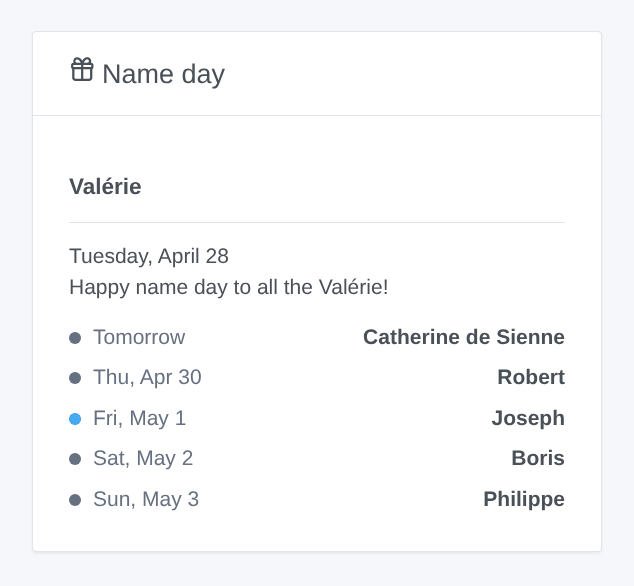
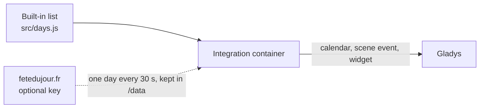

# Gladys Fête du jour

**English** · [Français](README.fr.md) · [Deutsch](README.de.md) · [Español](README.es.md)

[](LICENSE)
[](https://github.com/William-De71/gladys-fete-du-jour/releases)
[](https://github.com/William-De71/gladys-fete-du-jour/actions/workflows/release.yml)
[](https://gladysassistant.com)


[Gladys Assistant](https://gladysassistant.com) external integration bringing the name days of the traditional French calendar into Gladys: a calendar, a scene trigger, a scene action and a dashboard widget. The names come from a built-in list (offline, nothing to set) or from [fetedujour.fr](https://fetedujour.fr) with your own key.

User documentation: [English](docs/en.md) · [Français](docs/fr.md) · [Deutsch](docs/de.md) · [Español](docs/es.md).

## Features

- A **"Name days" Gladys calendar** for every user who enables the integration in "My calendars": one all-day event a day ("Bonne fête Valérie", "Fête nationale · Bonne fête Camille"), from 7 days back to a year ahead, in the language of each user.
- **Built-in list**: the traditional French calendar, one saint a day (351 first names) and the feasts, corrected against Wikipedia; works offline.
- **fetedujour.fr** (optional): with a free key tied to your fixed public IP address, each day is asked once (one request every 30 seconds) and kept; the built-in list takes over whenever the key is refused or the site does not answer.
- **Scene trigger** "Name day", every day at a chosen hour, optionally only on the name day of chosen first names. **Scene action** "Get the name day" (today or tomorrow), with a ready-made sentence.
- **Widget** "Name day": today and the next days.
- Days in the **timezone of Gladys**; four languages everywhere: English, French, German, Spanish.



## How it works



## Requirements

- Gladys Assistant **5.2.0** or later (calendar integrations).
- For fetedujour.fr only: a free key and a fixed public IP address.

## Installation

1. In Gladys, open **Integrations**, find **Fête du jour** and install it.
2. Optionally paste your fetedujour.fr key, then click **Enable for me** under **My calendars**; share the calendar with the household to use it in scenes.
3. Add the widget to a dashboard, and create scenes with the trigger and the action.

## Development

```bash
npm install
npm test                       # node --test, never touches the network
npm run lint && npm run format:check
npx github:GladysAssistant/integration-store . --skip-image-check
node scripts/sync-names.mjs    # first names of the list -> manifest
scripts/build-cover.sh         # cover.jpg from docs/assets/cover.svg
docs/illustrations/render.sh   # docs/assets/widgets.<lang>.png
node .github/scripts/release.mjs next
```

Locally, the SDK reads `GLADYS_HOST_API_URL`, `GLADYS_INTEGRATION_TOKEN` and `GLADYS_INTEGRATION_SELECTOR`, and `TZ` sets the timezone of the days; `DEBUG=gladys-integration-sdk` prints the SDK logs and checks every widget content. The tests fake fetedujour.fr. The rules of the project are in [CLAUDE.md](CLAUDE.md).

## Release process


Every merge on `main` runs the CI, then computes the version from the [Conventional Commits](https://www.conventionalcommits.org/) since the last tag: `feat` → minor, `fix` / `perf` → patch, `!` or `BREAKING CHANGE` → major (a minor before 1.0.0); `docs`, `chore`, `ci`, `test`, `style`, `refactor`, `build` alone publish nothing. The changelog section is generated, the tag pushed, the multi-arch image built, then `main` receives the release commit, the GitHub Release is created and a last job checks the public image, the store validator and the topic.

- The pull request title becomes the squash commit, then the changelog line: write it in English, for the user (`pr-title.yml` checks it). Never edit `CHANGELOG.md` by hand.
- 1.0.0 is a decision: Actions → Release → Run workflow with `release-as: 1.0.0`. `dry-run` shows the version and the notes without publishing anything.
- After the first release, make the `ghcr.io` package public (Package settings → Change visibility), otherwise Gladys cannot download it.

## Contributing

Issues and pull requests welcome. Run `npm run format:check && npm run lint && npm test` before opening a pull request, and never change a stored key (first-name keys, external ids: see [CLAUDE.md](CLAUDE.md)). A wrong name in the built-in list: open an issue with a source.

## Security

See [SECURITY.md](SECURITY.md): report vulnerabilities privately. The fetedujour.fr key is a secret field, never written to the logs; the integration runs read-only, without root rights, in its container, and only contacts fetedujour.fr (when a key is set).

## License

[Apache-2.0](LICENSE). The built-in list is derived from [scriptable-fete-du-jour](https://github.com/monsieurm/scriptable-fete-du-jour) (MIT): see [NOTICE](NOTICE). Not affiliated with fetedujour.fr.
